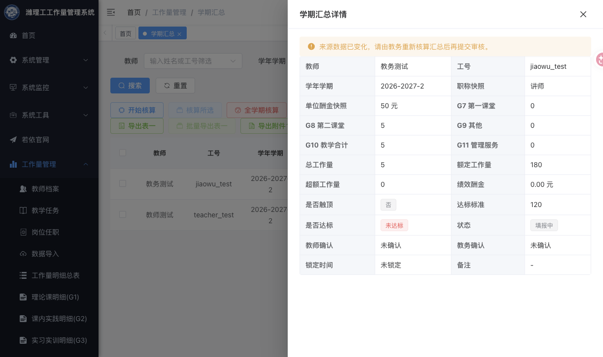
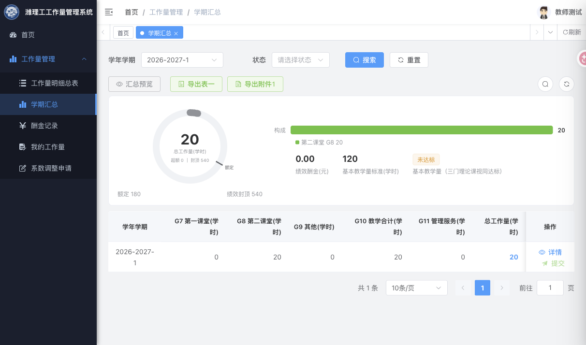

# T03 真实角色与汇总页面验收（2026-10-29）

T03补验通过，基线代码为`9438d9a`。本次新增验收证据，没有修改T03生产实现。结合2026-10-28的491项常规、31项MySQL及6项并发重复证据，T03路线图五项收口；不代表T05历史重现、T10全类别对账或整个系统终验。

## 隔离现场

- 工作树：`/Users/a1/.codex/worktrees/workload-baseline-integration/wfit--workload`，分支`codex/workload-baseline-integration`。
- 后端：127.0.0.1:18084；QA库：127.0.0.1:13306/wfit_ui_20261028；Redis：16379/database2。
- 前端：127.0.0.1:13000，Vite程序化启动覆盖代理至18084；未更改仓库默认代理8084。现场Node为22.22.3，本次只用于开发服务器浏览器补验，不冒充T04固定Node24构建证据。
- 四账号通过`/login`和`/getInfo`确认角色为biz_admin、assistant、teacher、leader，未修改角色授权。QA克隆中的验证码已关闭。
- 所有写入仅落QA克隆；仅为1002/1003新增讲师、专任、正常的测试档案，不修改正式人员。主流程用2026-2027-2；首次试跑2026-2027-1样本保留。
- 原工作区43个保全文件重新计算SHA-256，全部未变；未对原3306业务库执行测试、迁移或清理。未推送、合并、部署。

## 真实HTTP

`T03角色与页面证据.json`保留62条HTTP观察的角色、方法、路径、字段摘要及响应code/message，其中1条为缺少教务测试档案的夹具拒绝；补齐QA夹具后完成样本。其余关键动作断言均通过。完整脚本和原始记录存本机私有备份，Git证据不含密码、token或数据库连接凭据。

| 场景 | 实际结果 |
|---|---|
| 教师新增G8时伪造userId/status/source/task/sign | userId收口本人1003、status=0、source=SELF，不接受源关联或审批状态 |
| 教师请求其他人明细/汇总及伪造列表userId | 详情拒绝；QA只读复查确认501存在且归属user3，教师为user1003；列表仍仅本人 |
| 教师、院领导尝试核对或审批/通用编辑 | 当前真实权限拒绝，未扩权以制造可写场景 |
| 管理、教务通用编辑明细/汇总/酬金 | 汇总/酬金归属迁移拒绝，明细userId被过滤；计算值、状态、签字保持原值；允许备注白名单 |
| 改草稿来源后提交、单独重算酬金 | 均拒绝旧汇总 |
| 教务核对同一版本两次 | 首次成功，重复拒绝 |
| 教师提交→本人确认→教务驳回→重提→教务终审 | 审计日志依次记录0→1、1→1、1→0、0→1、1→2；驳回清旧签字 |
| 待审、完结时维护来源/通用编辑/重算/删酬金 | 拒绝，完结结果20学时保持不变 |
| 四角色请求完结解锁 | 均拒绝（权限层或永久锁定领域规则） |
| 管理、教务混合删除草稿与冻结明细 | 两次均拒绝，记录与汇总前后查询SHA-256一致，未部分删除/置脏 |

本次使用HTTP真实权限链，原IT的安全身份替身局限仍如实保留。手工G8样本不是G1—G6/G11实际文件导入与报表整链证明，后者由T10承担。

## 浏览器交互

使用ego-browser同一任务空间，通过登录表单实际登录管理、教师账号：

1. 管理列表可同时看到教务测试草稿和教师测试完结记录；草稿“需重新核算”，提交按钮DOM disabled=true；完结记录“已核算”，无提交、无解锁动作。
2. 点击草稿详情，抽屉显示“来源数据已变化，请由教务重新核算汇总后再提交审核。”；职称、费率、工作量、状态可读。
3. 打开完结更多菜单，仅重算/导出附件1/删除，无解锁。重算和删除等保留菜单仍由后端冻结拒绝；本任务未扩展为全面菜单清理。
4. 教师账号以首次试跑保留的2026-2027-1/summary105检查，列表只显示本人的一条草稿；无教师筛选/核算/删除管理入口；提交禁用，详情有同一警示。浏览器断言及截图保留，结束后关闭本任务创建的页面。

界面验收限管理/教师汇总相关交互；教务与院领导的真实身份在HTTP层验证，未声称四角色所有页面通过。技术和界面补验未发现需要修改生产代码的新T03缺陷。

## 后续

T05从按学期结束日选择规则/费率与缓存隔离开始。现有快照的RULE-学期标签尚非不可变政策版本，读取也未完成哈希兼容校验；本次不据T03收口宣称历史重算可复现。MySQL8/空库、远程CI、凭据轮换和发布边界不变。
